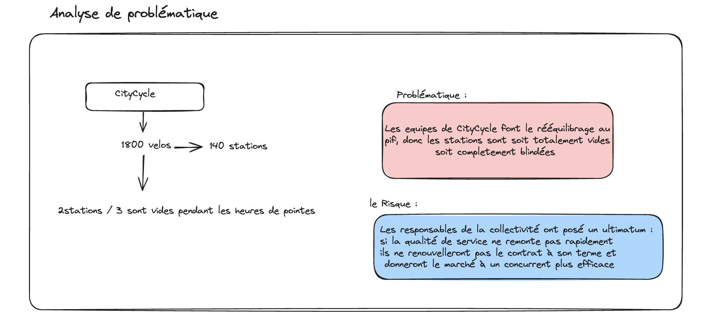

# 🚴‍♂️ Projet Citycycle — Optimisation Data Mining du Réseau

## 1. Contexte Métier & Ultimatum (Business Understanding)

Citycycle exploite 1 800 vélos sur 140 stations pour le compte d'une collectivité. Deux stations sur trois sont vides aux heures de pointe pendant que d'autres débordent, et le rééquilibrage se fait au jugé depuis trois ans. La collectivité a prévenu : si le taux de disponibilité ne remonte pas, la délégation ne sera pas renouvelée.

### 📍 Synthèse de la Problématique

---

### 🎯 Objectif du Projet & Démarche CRISP-DM
Face à cet ultimatum, l'objectif de ce projet Data Mining est de sortir d'une gestion empirique (« au pif ») pour mettre en place une stratégie opérationnelle pilotée par la donnée et basée sur 4 algorithmes clés :
* **Clustering (K-Means / DBSCAN) :** Segmenter les 140 stations et cibler les zones prioritaires de tension.
* **Régression Linéaire :** Anticiper les volumes de trajets et mesurer le poids réel des facteurs (météo, heures, emplacements).
* **Classification (k-NN / Régression Logistique) :** Identifier les profils d'abonnés à risque de résiliation (*churn*) pour sécuriser nos revenus.

Le présent document retrace l'intégralité de notre démarche CRISP-DM question par question : **la problématique métier**, **la méthode retenue et sa justification**, ainsi que **les conclusions et recommandations stratégiques** formulées pour la direction commerciale.

---
## 🛠️ 2. Data Preparation (Préparation des Données)

Le module `src/data_loader.py` prend en charge le nettoyage et l'enrichissement des données sources pour alimenter les modèles d'analyse :

* **Stations (`Citycycle_stations.csv`) :** Suppressions des doublons et imputation des valeurs manquantes d'interventions à 0.
* **Trajets (`Citycycle_trajets.csv`) :** Parsing temporel (`datetime`), extraction de l'heure et du jour, et création d'un indicateur binaire d'heures de pointe (7h-9h / 17h-19h).
* **Abonnés (`Citycycle_abonnes.csv`) :** Standardisation de la variable de résiliation (`target_churn` : 0 = résilié, 1 = renouvelé) pour la classification.