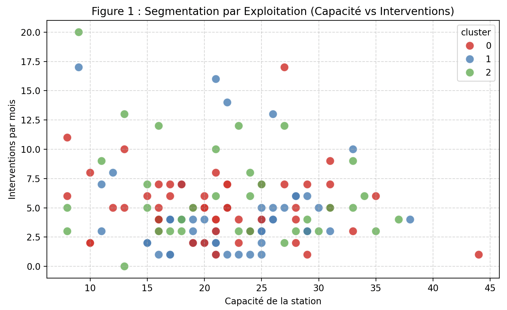
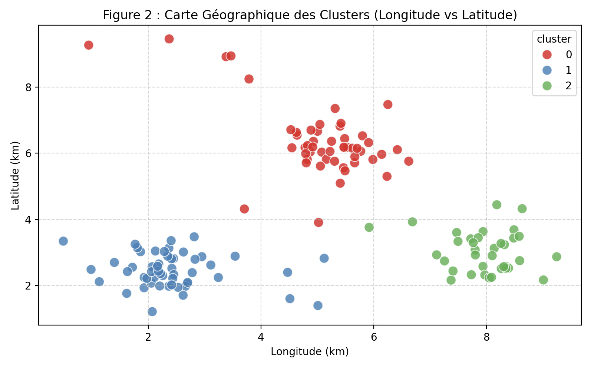
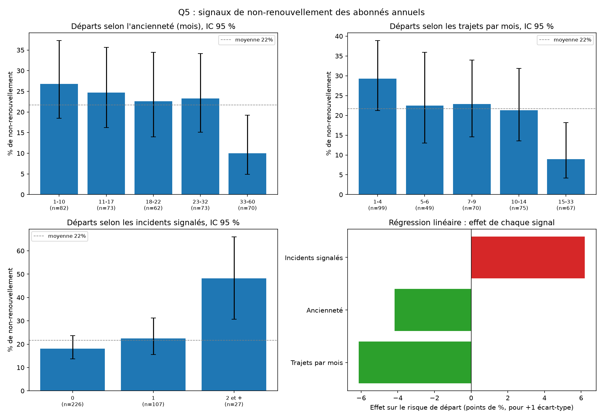
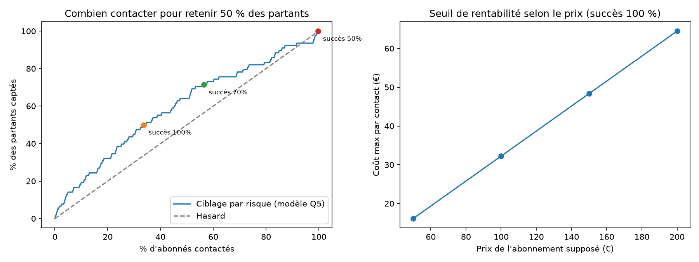

# Projet Citycycle — Optimisation Data Mining du Réseau

## 1. Contexte Métier & Ultimatum (Business Understanding)

Citycycle exploite 1 800 vélos sur 140 stations pour le compte d'une collectivité. Deux stations sur trois sont vides aux heures de pointe pendant que d'autres débordent, et le rééquilibrage se fait au jugé depuis trois ans. La collectivité a prévenu : si le taux de disponibilité ne remonte pas, la délégation ne sera pas renouvelée.

### Synthèse de la Problématique

---

### Objectif du Projet & Démarche CRISP-DM
Face à cet ultimatum, l'objectif de ce projet Data Mining est de sortir d'une gestion empirique (« au pif ») pour mettre en place une stratégie opérationnelle pilotée par la donnée et basée sur 4 algorithmes clés :
* **Clustering (K-Means / DBSCAN) :** Segmenter les 140 stations et cibler les zones prioritaires de tension.
* **Régression Linéaire :** Anticiper les volumes de trajets et mesurer le poids réel des facteurs (météo, heures, emplacements).
* **Classification (k-NN) :** Identifier les profils d'abonnés à risque de résiliation pour sécuriser nos revenus.

Le présent document retrace l'intégralité de notre démarche CRISP-DM question par question : **la problématique métier**, **la méthode retenue et sa justification**, ainsi que **les conclusions et recommandations stratégiques** formulées pour la direction commerciale.

---
## 🛠️ 2. Data Preparation (Préparation des Données)

Le module `src/data_loader.py` prend en charge le nettoyage et l'enrichissement des données sources pour alimenter les modèles d'analyse :

* **Stations (`Citycycle_stations.csv`, 140 lignes) :** Données déjà propres (aucun doublon, aucune valeur manquante). Le module supprime par sécurité les doublons éventuels et impute à 0 les interventions manquantes.
* **Trajets (`Citycycle_trajets.csv`, 760 → 697 lignes) :**
  * Suppression de 60 doublons ;
  * Suppression de 3 trajets de 1440 min (24 h, vélos non restitués ; seuil retenu : 180 min) ;
  * Recalcul des 3 distances à −1 à partir des coordonnées des stations (`distance_km` est une distance à vol d'oiseau) et repérage des 2 trajets en boucle de distance nulle (`est_boucle`) ;
  * Imputation de la température manquante par la médiane et du type d'abonnement manquant par `inconnu` ;
  * Création des indicateurs binaires `est_heure_pointe` (créneaux 7h-9h et 17h-19h, soit les heures 7, 8, 17 et 18) et `est_pluie`.
* **Abonnés (`Citycycle_abonnes.csv`, 500 lignes) :** Création de la variable cible `target_churn` pour la classification (1 = n'a pas renouvelé, 0 = a renouvelé).

Les données nettoyées sont exportées dans `data/processed/` en exécutant `python src/data_loader.py`. Chaque anomalie et la décision prise sont détaillées dans [`docs/journal_donnees.md`](docs/journal_donnees.md).

---

## 📊 3. Question 1 : Segmentation des Stations (Clustering K-Means)

### ❓ Problématique Métier
> *Comment regrouper les 140 stations qui rencontrent les mêmes problèmes (manque de vélos, saturation, pannes) afin d'organiser le rééquilibrage par type de quartier ?*

### ⚙️ Méthode Retenue (`src/clustering.py`)
* **Algorithme :** **K-Means ($K=3$)** — Choisi car nous n'avons pas d'étiquettes de quartiers dans le fichier CSV ; l'algorithme regroupe les stations automatiquement selon leurs points communs.
* **Prétraitement :** Suppression de `station_id` et mise à l'échelle des données (`StandardScaler`) pour que l'altitude et le nombre d'interventions aient le même poids.
* **Validation :** Score de Silhouette de **`0.2708`** (séparation cohérente des 3 groupes).

---

### 📈 Résultats Visuels & Analyse

#### Figure 1 : Exploitation (`Capacité` vs `Interventions/mois`)

* **Résultat :** À capacité égale (~22 bornes), le **Cluster 2** demande beaucoup plus d'interventions (**~5,9/mois**) que le **Cluster 1** (**~4,4/mois**).

* **Raisonnement :** Ce n'est pas la taille de la station qui crée les problèmes, mais l'usage et le relief.

#### Figure 2 : Carte Géographique (`Longitude` vs `Latitude`)

* **Résultat :** Les 3 couleurs forment 3 zones géographiques bien séparées sur la carte de la ville.
* **Raisonnement :** L'algorithme a retrouvé tout seul la géographie de la ville (hypercentre, quartiers résidentiels plats et quartiers en hauteur).
---

### 💼 Réponse Commerciale & Décisions

L'analyse identifie **3 types de quartiers** :

1. **Cluster 0 — Quartiers d'Affaires / Hypercentre (51 stations) :** Forte offre et forte demande. Risque de **saturation des bornes** le matin quand tout le monde arrive au travail.
2. **Cluster 1 — Quartiers Résidentiels (53 stations) :** **Stations vides tôt le matin** lors des départs vers le travail.
3. **Cluster 2 — Zones en Hauteur / Reliefs (36 stations) :** Altitude élevée (~60 m). Les usagers descendent à vélo en centre-ville mais ne remontent presque jamais les côtes, ce qui vide les stations et use davantage les vélos.

#### 🎯 Plan d'Action
* **Tournées des camions (6h - 9h) :** Remonter en priorité les vélos vers le **Cluster 2 (hauteurs)** le matin pour garantir la disponibilité aux usagers, et **vider les bornes du Cluster 0 (hypercentre)** avant 9h pour éviter la saturation.
* **Bonus Remontée :** Offrir des minutes gratuites aux abonnés qui ramènent un vélo du centre-ville vers les hauteurs (Cluster 2).
* **Maintenance ciblée :** Renforcer l'entretien technique sur les stations du Cluster 2.

### Q5 : quand et à quels signes repérer qu'un abonné annuel ne renouvellera pas ?
 
**Ce que j'ai compris.** Sur les 360 abonnés annuels, 78 n'ont pas renouvelé (22 %).
Il faut dire à partir de quelle ancienneté le risque change et quels comportements
annoncent un départ, pour pouvoir agir avant l'échéance.
 
**Résultat.**
 
- **Au bout de combien de temps :** le risque est élevé et stable pendant les
  32 premiers mois (24 % de départs), puis tombe à 10 % au-delà.
- **À quels signes :** trois signaux indépendants entre eux.
  - **Peu de trajets** (signal le plus fort) : 29 % de départs à 4 trajets par mois
    ou moins, contre 9 % au-delà de 14.
  - **2 incidents signalés ou plus** : 48 % de départs, contre 18 % sans incident.
  - **Ancienneté courte** : moins de 32 mois.
- La distance moyenne des trajets ne montre aucune tendance : elle n'est pas retenue.

 
*Lecture : chaque barre donne le taux de départ d'un groupe, avec son intervalle de
confiance à 95 % et son effectif (n). La ligne pointillée est la moyenne (22 %).
Le dernier graphique montre le poids de chaque variable dans le modèle : à gauche
elle protège du départ, à droite elle y pousse.*
 
**Méthode.** Régression logistique sur l'ancienneté, les trajets par mois et les
incidents (variables standardisées pour être comparables). Elle a été choisie pour
deux raisons :
 
1. Ses coefficients se lisent directement : trajets −0,45, incidents +0,31,
   ancienneté −0,24.
2. Elle fait mieux qu'un arbre de décision en validation croisée (AUC 0,64 contre
   0,55 à 0,58). Avec 360 abonnés, un arbre ne trouve pas de bons découpages.
Remplacer l'ancienneté par une variable « plus de 30 mois » n'apporte presque rien
(AUC 0,65 contre 0,64, bien en dessous de la variabilité) : on garde la version simple.
 
**Vérification.**
 
| Ce qu'on a vérifié | Résultat |
|---|---|
| AUC en validation croisée stratifiée (5 plis × 10 répétitions) | 0,64 (écart-type 0,07), contre 0,50 au hasard |
| Matrice de confusion, prédictions hors échantillon | 50 partants repérés sur 78 (rappel 64 %), pour 104 fausses alertes (précision 32 %) |
| Taux de départ avant / après 32 mois | 24 % (IC 95 % : 20-30 %, n = 290) contre 10 % (IC 95 % : 5-19 %, n = 70) : les intervalles ne se chevauchent pas |
| Stabilité du seuil (choisi sur les mêmes données) | Choix refait sur 1 000 rééchantillonnages : 32 mois ressort dans 84 % des cas |
 
Matrice de confusion (prédictions hors échantillon : chaque abonné est noté par un
modèle qui ne l'a pas vu) :
 
| | Prédit : renouvelle | Prédit : part |
|---|---|---|
| **Réel : renouvelle** | 178 | 104 |
| **Réel : part** | 28 | 50 |
 
**Limites.** Le seuil est stable, mais l'écart au-delà de 32 mois repose sur
7 départs seulement. Le modèle classe les abonnés par niveau de risque, il ne prédit
pas avec certitude qui partira. Ce sont des associations : un abonné qui a eu des
incidents ne part pas forcément à cause d'eux.
 
**Recommandation.** Surveiller en priorité les abonnés qui roulent peu ou qui ont
signalé 2 incidents ou plus, surtout pendant leurs 32 premiers mois, et les contacter
avant l'échéance de renouvellement. Q6 chiffre combien en contacter et à quel coût.
 
---
 
### Q6 : combien d'abonnés solliciter pour retenir la moitié des partants, et à partir de quel coût l'opération ne vaut plus le coup ?
 
**Ce que j'ai compris.** On contacte les abonnés du plus risqué au moins risqué
(classement du modèle de Q5). Il faut distinguer deux choses :
 
- **capter** un partant, c'est le contacter ;
- le **retenir**, c'est que la relance marche.
Retenus = captés × taux de succès de la relance. Pour retenir la moitié des partants,
il faut donc en capter 50 % ÷ taux de succès.
 
**Résultat.** Contacter **un tiers des abonnés annuels** (117 sur 360), les plus à
risque, suffit à capter la moitié des partants (39 sur 78). Au hasard, il faudrait
en contacter la moitié : le ciblage est environ 1,5 fois plus efficace.
 
Mais **retenir** la moitié dépend du taux de succès de la relance, que les données
ne donnent pas :
 
| Taux de succès de la relance | Abonnés à contacter pour retenir 50 % des partants | Coût maximal par contact (abonnement à 100 €) |
|---|---|---|
| 100 % | 32 % (117) | 33 € |
| 70 % | 65 % (234) | 17 € |
| 50 % | quasiment tous (359) | 11 € |
| moins de 50 % | **impossible**, même en contactant tout le monde | — |
 

 
*Lecture : à gauche, la courbe bleue montre la part des partants captés selon la part
d'abonnés contactés ; plus elle est au-dessus de la diagonale (le hasard), meilleur
est le ciblage. Les points indiquent combien contacter selon le taux de succès. À
droite, le coût maximal par contact selon le prix de l'abonnement supposé.*
 
**Méthode.** Courbe de gain, calculée sur le risque de chaque abonné obtenu en
validation croisée (Q5) : le risque d'un abonné vient d'un modèle qui ne l'a pas vu,
ce qui évite un résultat trop optimiste.
Seuil de rentabilité = prix de l'abonnement × abonnés retenus ÷ abonnés contactés.
Au-delà de ce coût par contact, l'opération dépense plus qu'elle ne rapporte.
Cette méthode se lit sans formule par un directeur commercial.
 
**Hypothèses (le sujet ne fournit ni le prix ni le taux de succès).**
 
- **Prix de l'abonnement : 100 €.** Le seuil est proportionnel au prix :
  50 € → 17 €, 100 € → 33 €, 150 € → 50 €, 200 € → 67 € par contact
  (avec 100 % de succès).
- **Taux de succès :** non observé. Le seuil de 33 € est donc un **plafond** :
  il suppose que chaque partant contacté est retenu.
**Vérification et limites.** Le ciblage fait mieux que le hasard (32 % des abonnés
à contacter au lieu de 50 %), sans être précis (AUC de Q5 : 0,64). Le résultat repose
sur 78 partants seulement : il faut le lire comme un ordre de grandeur (« environ un
tiers des abonnés »), pas comme un chiffre exact.
 
**Recommandation.**
 
1. Lancer une **première vague** sur le tiers des abonnés les plus à risque, avec une
   action qui coûte moins de 33 € par contact (pour un abonnement à 100 €).
2. **Mesurer le taux de succès réel** sur cette vague : c'est lui qui décide si
   l'objectif « retenir la moitié des partants » est atteignable.
3. Si le taux de succès est inférieur à 50 %, viser un objectif plus bas que la
   moitié, ou combiner la relance avec une action sur les causes (incidents, faible
   usage repérés en Q5).
 